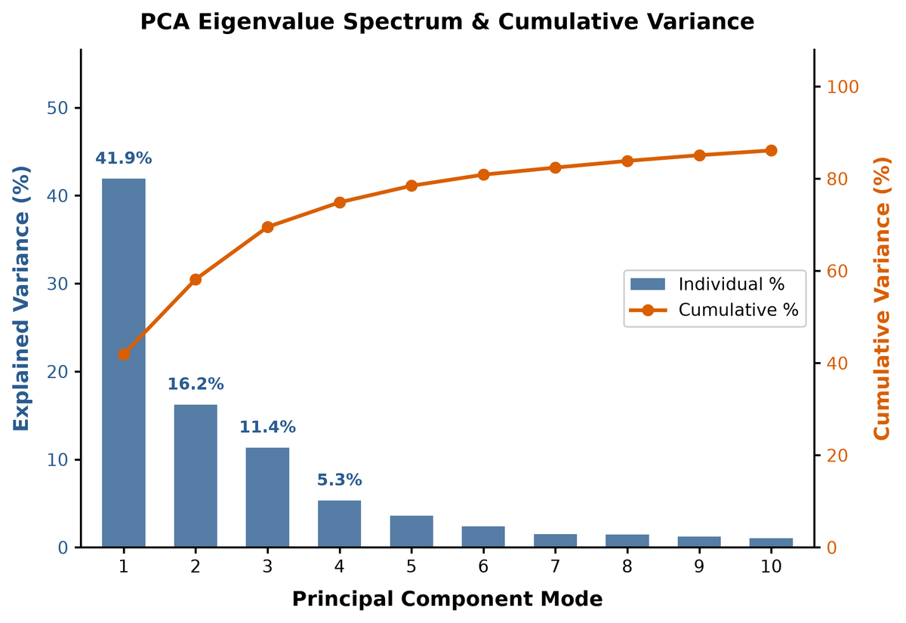
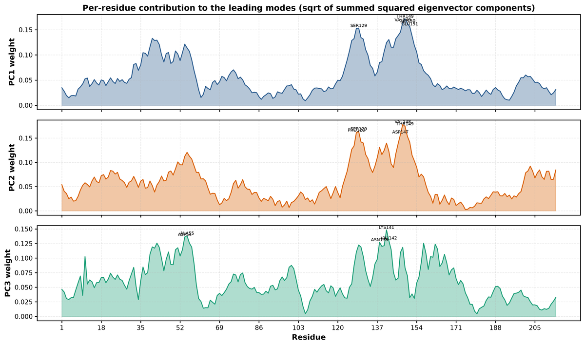
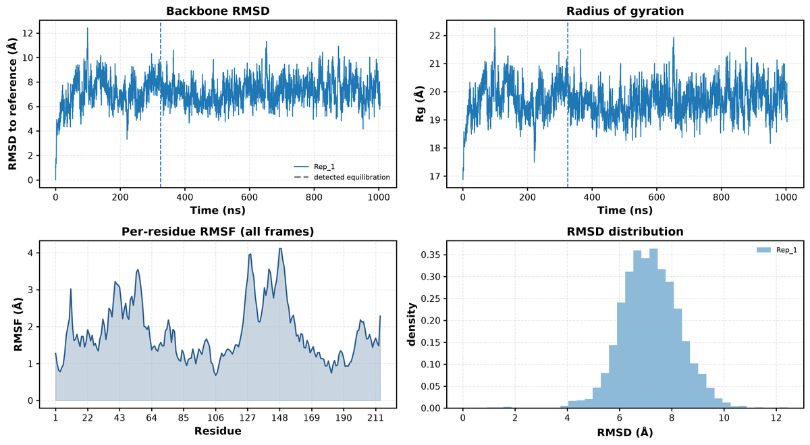
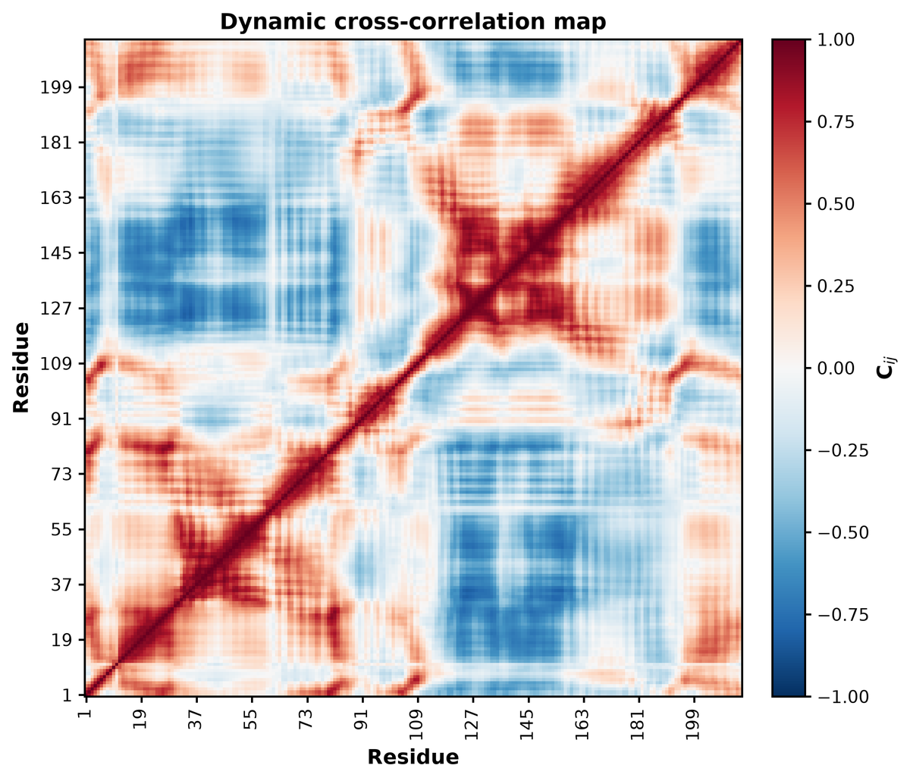
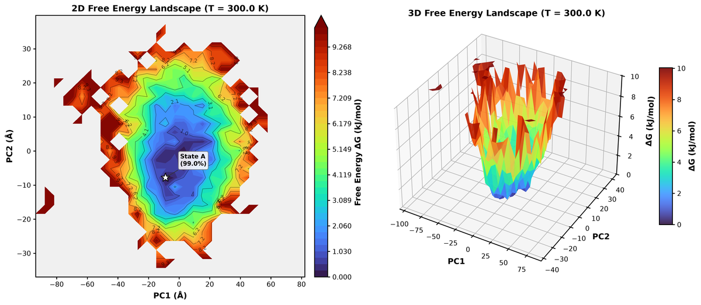
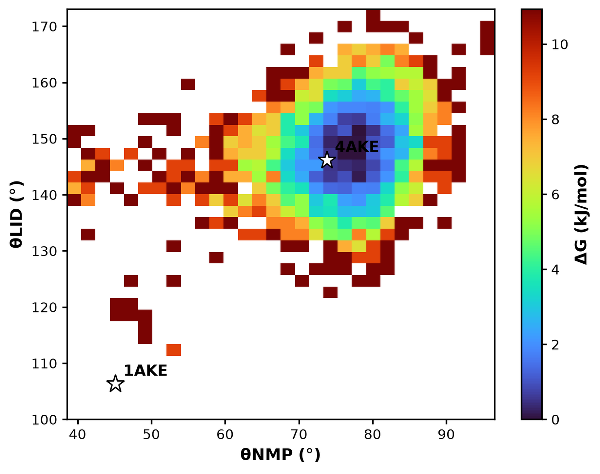
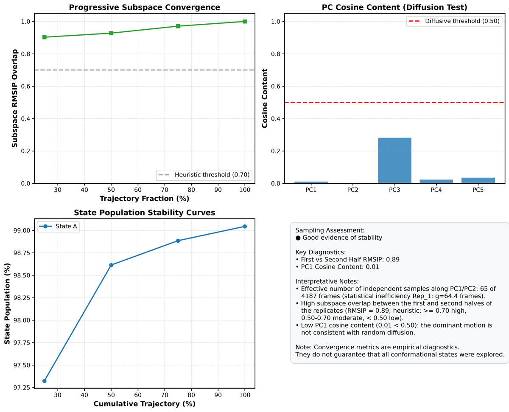
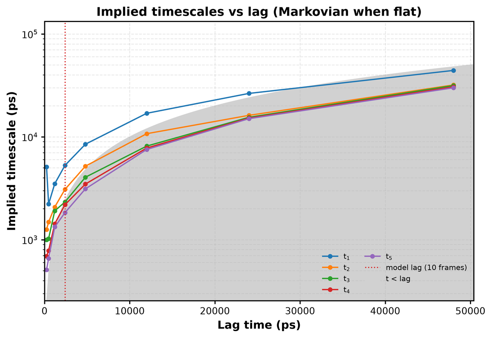
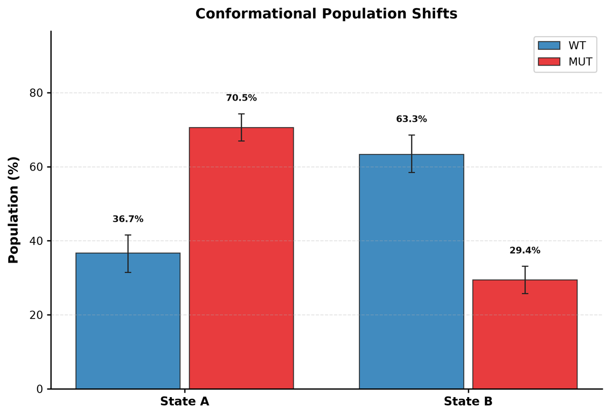
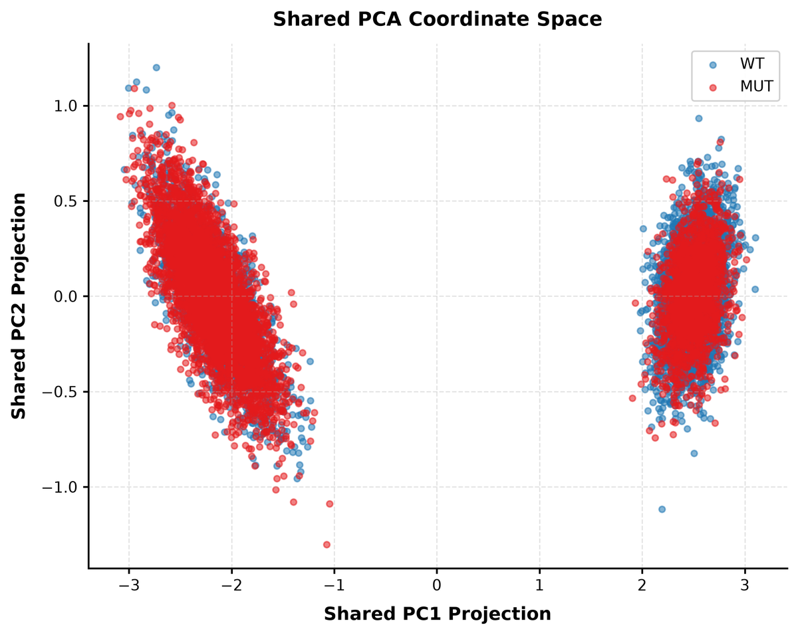

# Tutorial: adenylate kinase opening, and a comparison with a known answer

This tutorial runs every analysis of ConformAtlas on a published 1 µs simulation of
*E. coli* adenylate kinase (ADK). It checks the results against the open and closed
crystal structures, then uses a synthetic two-condition dataset, where the true answer
is known, to show what `conformatlas compare` reports. Every command runs from the
repository root in under a minute. Every number quoted below is re-derived from the
output files by `validation/validate.py`.

## 1. The system and the data

ADK is a three-domain enzyme. Its NMP-binding domain (residues 30–59) and LID
domain (122–159) close over the CORE when substrates bind. The crystal structure
1AKE (with the inhibitor Ap5A) is closed and 4AKE (apo) is open.

`examples/adk/` holds a reduced copy of an equilibrium simulation of apo ADK by
Seyler and Beckstein: CHARMM27, explicit water and ions, NPT at 300 K and 1 bar,
1.004 µs on Anton, 4,187 frames 240 ps apart, protein only, superposed on the CORE
domain (figshare,
[doi:10.6084/m9.figshare.5108170](https://doi.org/10.6084/m9.figshare.5108170),
CC BY 4.0). The deposit does not state the starting structure. The file name
(`1ake_007`) and a first frame close to the closed crystal structure (section 3)
indicate a start from 1AKE. Only the 214 Cα atoms are kept (4 MB). `examples/adk/make_adk_data.py`
rebuilds every file from the original download and checks its md5 sum.

| File | Content |
|---|---|
| `adk_ca.pdb`, `adk_ca.xtc` | Cα topology and the full trajectory |
| `index.ndx` | groups `C-alpha`, `CORE`, `NMP`, `LID` |
| `domain_angles.dat` | time and the two domain angles θNMP, θLID per frame, from the backbone of the full-atom trajectory |
| `crystal/1ake_A_ca.pdb`, `crystal/4ake_A_ca.pdb` | Cα of the two crystal structures (RCSB PDB) |
| `crystal/crystal_angles.json` | θNMP, θLID of the crystal structures, same definition |

The angles follow Beckstein *et al.* (2009): θNMP is the angle between the centres of
residues 115–125, 90–100 and 35–55; θLID between 179–185, 115–125 and 125–153. For
the crystal structures they are 45.1° / 106.3° (closed 1AKE) and 73.8° / 146.2°
(open 4AKE).

```bash
ls examples/adk examples/adk/crystal
cat examples/adk/crystal/crystal_angles.json
```

## 2. One command for the whole analysis

```bash
conformatlas analyze \
    -s examples/adk/adk_ca.pdb -f examples/adk/adk_ca.xtc -n examples/adk/index.ndx \
    -l C-alpha -c C-alpha -T 300 --bins 30 --bootstrap 200 \
    --msm --msm-lags 1,2,5,10,20,50,100,200 \
    --residue-analysis --n-representatives 3 \
    -o tutorial/adk
```

The command performs these steps in order:
1. Superposes every frame on the Cα atoms of `adk_ca.pdb`.
2. Runs a Cartesian PCA of the Cα atoms.
3. Builds the free-energy landscape on PC1–PC2 on a 30 × 30 grid.
4. Finds the states by watershed segmentation.
5. Computes the convergence diagnostics.
6. Bootstraps 200 times.
7. Builds a Markov state model with an implied-timescale scan over eight lag times.
8. Runs the residue-level analyses (RMSF, dynamic cross-correlation).
9. Writes three representative structures per state, the figures and `report.html`.

The console summary (abridged):

```text
  NOTE: Rep_1: equilibration detection suggests discarding the first 1352 frames (32%, t0 = 324480 ps); run with --equilibration auto or -b 324480 to apply.
  • Leading two modes explain 58.2% of the variance
Identified 1 major states (pop >= 5.0%): State A: 99.0% (Unassigned / Minor: 1.0%)
  • Half-vs-half RMSIP: 0.89 | PC1 cosine content: 0.01
  • Assessment: Good evidence of stability
  • State A: population 99.0% [98.0, 99.7] | ΔG vs State A = -0.00 [-0.00, 0.00] kJ/mol
  • 100 microstates in PC1, PC2, PC3; 97 active; lag 10 frames (2400.0 ps); 2 PCCA+ sets
  • Chapman-Kolmogorov: passed (max |deviation| 0.276)
```

**Why 30 bins and no smoothing.** The automatic Freedman–Diaconis rule chooses 62
bins per axis for these 4,187 frames. That leaves the edge of the basin as isolated
single-frame bins. Gaussian smoothing (`--smooth-sigma`) would hide this, but it also
spreads probability into bins that were never sampled. The few frames of the opening
transition would then look like a continuous valley, coloured as if it had been
sampled. With 30 bins and no smoothing, every coloured bin was visited.

## 3. What moves: the essential modes



PC1, PC2 and PC3 carry 41.9 %, 16.2 % and 11.4 % of the Cα variance
(`pca/explained_variance.csv`). The LID and NMP domains are 38 and 30 of the 214
residues, but they carry 34.5 % and 23.6 % of PC1
(`pca/mode_contributions_residues.csv`). The largest PC1 weight is on Thr149 at the
tip of the LID.



The Cα RMSF (`descriptors/rmsf_residues.csv`) averages 2.89 Å in the LID,
2.57 Å in the NMP domain and 1.43 Å in the CORE, with a maximum of 4.12 Å at Thr149.
The dynamic cross-correlation map (`residues/dccm.npy`) shows the two lids moving
against each other: the mean correlation between LID and NMP residues is −0.54,
while LID residues correlate with each other at 0.72 on average.





**Where are the crystal structures on these modes?** The run stores the mean
structure and the eigenvectors, so any structure can be projected after the same
superposition on `adk_ca.pdb`:

```python
import MDAnalysis as mda
import numpy as np


def superpose(x, ref):
    """Least-squares fit of x onto ref (N x 3), the fit conformatlas applies with -s."""
    xc, rc = x - x.mean(0), ref - ref.mean(0)
    u, _, vt = np.linalg.svd(xc.T @ rc)
    d = np.sign(np.linalg.det(u @ vt))
    return xc @ (u @ np.diag([1.0, 1.0, d]) @ vt) + ref.mean(0)


ref = mda.Universe("examples/adk/adk_ca.pdb").atoms.positions.astype(float)
mean = np.load("tutorial/adk/pca/mean_coordinates.npy")
vecs = np.load("tutorial/adk/pca/eigenvectors.npy")
for name in ("1ake", "4ake"):
    x = mda.Universe(f"examples/adk/crystal/{name}_A_ca.pdb").atoms.positions.astype(float)
    pc = (superpose(x, ref).ravel() - mean.ravel()) @ vecs[:, :2]
    print(f"{name.upper()}: PC1 = {pc[0]:.1f} Å, PC2 = {pc[1]:.1f} Å")
```

```text
1AKE: PC1 = -100.8 Å, PC2 = -27.9 Å
4AKE: PC1 = -7.4 Å, PC2 = -11.6 Å
```

The closed crystal structure lies at the far negative end of PC1, next to the first
frame of the trajectory (PC1 = −92.9 Å, `pca/projections.csv`). The open crystal
structure lies inside the basin. PC1 is the closed-to-open motion.

## 4. The free-energy landscape and its single state



`states/` reports one major state, State A, holding 99.0 % of the frames. Its
bootstrap 95 % interval is [98.0, 99.7] % (`statistics/state_populations.csv`) and its
minimum is at PC1 = −8.9 Å, PC2 = −7.8 Å, a few ångström from the 4AKE projection.
The remaining 1.0 % are the frames of the opening transition, on the left of the map.
They form no basin because the simulation passes through that region only once. The
3D panel draws sampled bins only.

The landscape on the two domain angles shows the same picture in coordinates that
can be read against experiment. `--cv file` replaces the PCs by the columns of
`domain_angles.dat`:

```bash
conformatlas analyze \
    -s examples/adk/adk_ca.pdb -f examples/adk/adk_ca.xtc -n examples/adk/index.ndx \
    -l C-alpha -c C-alpha -T 300 --bins 30 --bootstrap 200 \
    --cv file --cv-file examples/adk/domain_angles.dat --cv-labels "θNMP (°),θLID (°)" \
    -o tutorial/adk_angles
```

```python
import json

import matplotlib

matplotlib.use("Agg")
import matplotlib.pyplot as plt
import numpy as np

from conformatlas.plotting import landscape_cmap

d = "tutorial/adk_angles/fel/"
G = np.load(d + "free_energy.npy")  # shape (n_y, n_x), NaN = never sampled
xe, ye = np.load(d + "x_edges.npy"), np.load(d + "y_edges.npy")
crystals = json.load(open("examples/adk/crystal/crystal_angles.json"))

fig, ax = plt.subplots(figsize=(6.4, 5.0))
mesh = ax.pcolormesh(xe, ye, G, cmap=landscape_cmap(), shading="flat")
fig.colorbar(mesh, ax=ax, label="ΔG (kJ/mol)")
for name, a in crystals.items():
    x, y = a["theta_NMP"], a["theta_LID"]
    ax.plot(x, y, marker="*", ms=14, mec="k", mfc="w")
    ax.annotate(name, (x, y), xytext=(6, 6), textcoords="offset points", weight="bold")
    i, j = np.searchsorted(xe, x) - 1, np.searchsorted(ye, y) - 1
    inside = 0 <= i < G.shape[1] and 0 <= j < G.shape[0]
    g = G[j, i] if inside else np.nan
    where = f"ΔG of its bin {g:.1f} kJ/mol" if np.isfinite(g) else "outside the sampled region"
    print(f"{name}: θNMP {x:.1f}°, θLID {y:.1f}°, {where}")
ax.set_xlim(min(xe[0], 40), xe[-1])
ax.set_ylim(min(ye[0], 100), ye[-1])
ax.set_xlabel("θNMP (°)")
ax.set_ylabel("θLID (°)")
fig.tight_layout()
fig.savefig("tutorial/adk_angles/figures/fel_angles_crystals.png", dpi=200)
```

```text
1AKE: θNMP 45.1°, θLID 106.3°, outside the sampled region
4AKE: θNMP 73.8°, θLID 146.2°, ΔG of its bin 0.5 kJ/mol
```



The minimum of the angle landscape is at θNMP = 76.2°, θLID = 147.3° (`summary.json`
of `tutorial/adk_angles`). That is within 3° of the open crystal structure, whose bin
lies 0.5 kJ/mol above the minimum. The closed crystal geometry lies outside the
sampled region. Even the first frame of the deposited trajectory is partly open
(θLID 113.4°). θLID is below 120° only during the
first 2 ns (minimum 111.3°) and stays above 122.1° after 20 ns. Apo ADK in this force
field opens within the first tens of nanoseconds and stays open.

(tutorial-why-neff)=
## 5. Is it converged? What the diagnostics can and cannot say



The verdict is **Good evidence of stability**, and the open basin is indeed
well-sampled:
- The essential subspaces of the two halves of the run overlap with RMSIP 0.89.
- PC1 has a cosine content of 0.01, far from random diffusion (`convergence/`).

The diagnostics also show how little independent information the run holds. PC1 has
a statistical inefficiency of 64.4 frames (15.4 ns), so the 4,187 frames amount to
about 65 independent samples (`convergence/effective_samples.csv`).

The verdict concerns the basin that was sampled. It cannot say anything about the
closed state. The simulation left it once and never came back, so this run carries no
information on the closed-state population or on the closing rate.

**Equilibration.** The NOTE in the console comes from the Chodera criterion on the
fit-group RMSD (dashed line in the RMSD panel). It chooses the start that maximises
the number of effective production samples, which is at 324 ns. With
`--equilibration auto --equilibration-on cv` the criterion is also applied to PC1 and
PC2, and the later of the two starts is used:

```bash
conformatlas analyze \
    -s examples/adk/adk_ca.pdb -f examples/adk/adk_ca.xtc -n examples/adk/index.ndx \
    -l C-alpha -c C-alpha -T 300 --bins 30 --bootstrap 0 \
    --equilibration auto --equilibration-on cv \
    -o tutorial/adk_equilibrated
```

This discards 1,352 frames on the RMSD and a further 779 on the CVs, so production
starts at 511 ns (`convergence/equilibration.csv`). The criterion is an optimisation
heuristic, not a detector of the physical transition. The domain angles show that the
opening is complete within about 50 ns, and the slow fluctuations of the open LID make
the criterion cut much later. Treat its suggestion as a prompt to look at the time
series, not as a rule.

## 6. The Markov state model, and why not to trust its timescales here



The implied timescales do not level off with lag time. The slowest one is 5.1 ns at a
lag of 0.24 ns and 44.2 ns at a lag of 48 ns (`msm/implied_timescales.csv`), and
`msm/msm_summary.json` records `plateau_found: false`. Timescales that grow with the
lag, close to the "t < lag" boundary, mean the model is not Markovian at any lag
tested.

The Chapman–Kolmogorov test passes (maximum deviation 0.276, `msm/ck_test.csv`) only
because its tolerance uses the statistical uncertainty of each prediction, and the
uncertainty is large when the slow process happens once. The two PCCA+ sets split the
opening-region frames (set MS1, stationary probability 0.084, median time 34 ns) from
the open state (MS2, 0.916).

Kinetics need many transitions in both directions: several independent simulations,
or enhanced sampling followed by reweighting. A single opening event gives the
pipeline nothing to estimate a rate from, and ConformAtlas reports that rather than a
number.

## 7. Comparing two conditions when the answer is known

ADK has only one condition here. To show what `compare` reports, the built-in example
generator writes a synthetic WT/MUT dataset whose answer is known exactly:
- It is a 5-residue peptide hopping between a bent and a twisted conformation by a
  two-state Markov process.
- Every frame has random rigid-body motion added.
- The stationary bent-state population is 65 % for WT and 30 % for MUT, so the true
  difference MUT − WT is −35 percentage points.
- Each system has three replicates of 2,000 frames.

```bash
conformatlas example -o tutorial/wt_mut --replicates 3 --frames 2000
conformatlas compare --config tutorial/wt_mut/comparison.yaml -o tutorial/wt_mut/results
```

The shared landscape has two states. Labels are assigned by pooled population, so the
bent conformation is State B here. From `comparison/state_population_comparison.csv`
(populations in %, differences in percentage points):

| State | WT | MUT | MUT − WT | bootstrap 95 % CI | Welch 95 % CI | Welch p |
|---|---|---|---|---|---|---|
| State A | 36.7 | 70.5 | +33.9 | [27.3, 39.6] | [23.5, 44.2] | 0.0016 |
| State B | 63.3 | 29.4 | −33.9 | [−39.6, −27.3] | [−44.2, −23.5] | 0.0016 |



The comparison recovers the truth:
- **Populations.** WT is in the bent state 63.3 % of the time (true 65 %) and MUT
  29.4 % (true 30 %).
- **Difference.** The estimate is −33.9 points against a true −35. Both intervals
  contain the true value.
- **Welch's test.** It treats each of the 3 + 3 replicates as one independent
  measurement and is the primary test. It finds the difference with p = 0.0016 on 3.2
  degrees of freedom.
- **Bootstrap.** It resamples replicates and then blocks of frames inside each, and
  its interval is somewhat narrower.
- **Replicate agreement.** The heterogeneity ratios are 1.71 (WT) and 1.05 (MUT),
  below the warning level of 2. The replicates of each system agree, so `compare`
  issues no warning.



Real simulations are rarely this well behaved. When the replicates of one condition
sample different regions, the heterogeneity ratio rises above 2 and `compare` warns
that the difference cannot be trusted yet. See [Comparison](comparison.md) and the
null test on published T4 lysozyme replicates in `benchmarks/RESULTS_T4L_HIV.md`.

## 8. What to take away

- One command produced the whole analysis of a 1 µs trajectory in seconds. The open
  basin it finds agrees with the open crystal structure within 3° in both domain angles.
- PC1 is the closing motion, carried by the LID and NMP domains, which move in
  anticorrelated fashion.
- The diagnostics separate what the run can support (the open-state landscape) from
  what it cannot (the closed-state population, the kinetics). The MSM says so instead
  of returning a rate.
- Choices that change the picture, such as bins, smoothing and the equilibration cut,
  are explicit options. The run records every one of them in `run_metadata.json`.
- `compare` recovers a known population shift, with intervals that contain the truth.

Next: [Interpretation](interpretation.md), [Convergence](convergence.md),
[Multiple replicates](multiple_replicates.md), [Comparison](comparison.md),
[FAQ](faq.md).
