# Tutorial: influenza neuraminidase with zanamivir

This tutorial runs the complete `conformatlas analyze` and `conformatlas compare`
workflows on a small real-protein data set that ships with the repository, reads
every output section, and interprets the figures. Every command below was run as
shown; the numbers quoted are copied from the files it produced. The validation
script `validation/checks_docs.py` re-runs the commands and re-reads the output
files, so the text and the numbers cannot drift apart silently.

```{contents}
:local:
:depth: 2
```

## The data set

`tests/data/h1n1_ca/` contains a 20 ns molecular dynamics trajectory of the
influenza A/H1N1 neuraminidase head domain in complex with the inhibitor zanamivir
(residue name `ZMR`), reduced to the 387 Cα atoms of the protein and the
24 heavy atoms of the ligand (411 atoms) so that it fits in the repository (190 kB):

| File | Content |
|---|---|
| `neuraminidase_ca.pdb` | Topology and superposition reference (frame 0), 411 atoms |
| `neuraminidase_ca.xtc` | 81 frames, 0–20 000 ps, 250 ps apart |
| `index.ndx` | GROMACS index groups `System`, `C-alpha` (387 atoms), `ZMR` (24 atoms) |

Eighty-one frames is far too few for a publishable landscape (see
[Why N_eff is so small](#tutorial-why-neff)); it is
enough to exercise every feature on a real protein in about ten seconds.

Because the fixture holds only Cα atoms, the default fit/analysis group `Backbone`
(N, CA, C) is not available and the `C-alpha` index group is used instead. The
ligand is added to the analysis group with `--lig ZMR` so that its displacement
relative to the protein enters the covariance matrix and its own RMSD is reported.

## 1. Install

Install the package with the development extras (MDAnalysis, pytest). GROMACS is
optional for `analyze`; this tutorial uses `gmx trjconv` only to cut the trajectory
into pieces for the comparison section. All commands are run from the root of a
ConformAtlas checkout and write to `tutorial/`.

```shell
git clone https://github.com/AtharvaTilewale/ConformAtlas.git
cd ConformAtlas
python -m venv .venv && source .venv/bin/activate
pip install -e ".[dev]"
```

`conformatlas doctor` lists the detected dependencies and GROMACS version.

```bash
conformatlas doctor
```

## 2. Inspect the trajectory

Before analysing, confirm frame count, time range and atom groups. MDAnalysis
reads the same files ConformAtlas will use:

```python
import MDAnalysis as mda

u = mda.Universe("tests/data/h1n1_ca/neuraminidase_ca.pdb", "tests/data/h1n1_ca/neuraminidase_ca.xtc")
print(u.atoms.n_atoms, len(u.trajectory), u.trajectory[0].time, u.trajectory[-1].time, u.trajectory.dt)
print(u.select_atoms("name CA").n_atoms, u.select_atoms("resname ZMR").n_atoms)
```

```text
411 81 0.0 20000.0 250.0
387 24
```

The trajectory has already been made whole and centred (`gmx trjconv -pbc mol
-center`); ConformAtlas warns when consecutive Cα atoms are farther apart than a
peptide bond allows, which is the usual symptom of a molecule broken across the
periodic boundary.

## 3. Run the analysis

```bash
conformatlas analyze \
    -s tests/data/h1n1_ca/neuraminidase_ca.pdb \
    -f tests/data/h1n1_ca/neuraminidase_ca.xtc \
    -n tests/data/h1n1_ca/index.ndx \
    --lsq-group C-alpha --cov-group C-alpha --lig ZMR \
    -T 300 --bins 12 \
    -o tutorial/analysis
```

Options used:

- `-n index.ndx` makes the group names `C-alpha` and `ZMR` available to `-l`, `-c` and `-g`.
- `--lsq-group C-alpha` superposes every frame on the Cα atoms of the PDB file
  (Kabsch least-squares fit) before the covariance matrix is built; `--cov-group
  C-alpha` restricts the analysis to those atoms, and `--lig ZMR` appends the
  ligand heavy atoms to the analysis group.
- `-T 300` is the simulation temperature; it enters only through kT in
  ΔG = −kT ln(P/P_max). There is no default temperature: the value must be stated.
- `--bins 12`: with 81 frames the automatic Freedman–Diaconis grid would be clipped
  to its minimum of 16 bins per axis and most bins would hold a single frame; a
  12 × 12 grid is a compromise between resolution and counting noise. For
  production runs leave `--bins auto`.
- The block bootstrap runs with its default of 200 resamples and `--seed 0`, so the
  intervals below are reproducible.

The run prints a summary of each step; the lines that matter are reproduced here.

```text
  • Analysis group: C-alpha + ZMR (387 + 24 atoms); fit group: C-alpha (387 atoms)
  NOTE: Rep_1: equilibration detection suggests discarding the first 44 frames (54%, t0 = 11000 ps)
  • Leading two modes explain 38.0% of the variance
  WARNING: PC1+PC2 explain only 38.0% of the variance; a 2-D landscape on them captures a minority of the motion.
Identified 2 major states (pop >= 5.0%): State A: 46.9%, State B: 39.5% (Unassigned / Minor: 13.6%)
  • Half-vs-half RMSIP: 0.39 | PC1 cosine content: 0.92
  • Assessment: Insufficient evidence
2 warning(s) recorded in run_metadata.json
```

Both warnings are genuine findings about this data set, not configuration
errors, and both are stored in `run_metadata.json` under `warnings`.

## 4. Read the outputs

The output directory follows the manifest in [Outputs](outputs.md). The sections
below go through it in the order of the HTML report (`tutorial/analysis/report.html`).

### 4.1 Decomposition (`pca/`)

`pca/explained_variance.csv` lists the eigenvalues (Ų, because the Python backend
works in Å) and the variance fractions:

| Mode | Eigenvalue (Ų) | Variance (%) | Cumulative (%) |
|---|---|---|---|
| 1 | 110.3 | 25.9 | 25.9 |
| 2 | 51.7 | 12.1 | 38.0 |
| 3 | 28.2 | 6.6 | 44.6 |

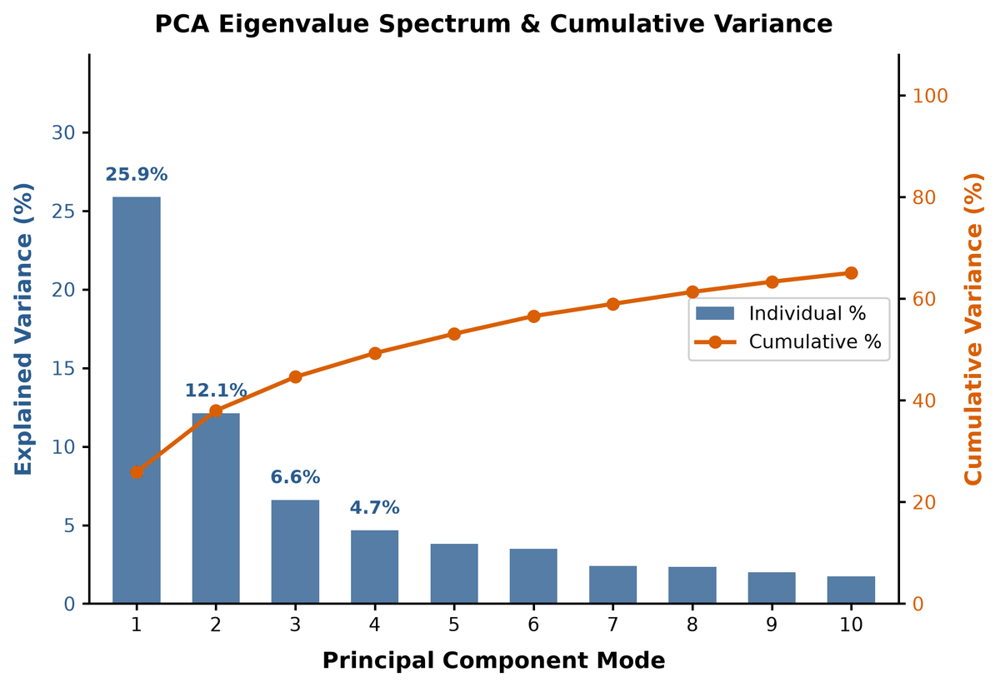

PC1 and PC2 together describe 38.0 % of the Cα + ligand fluctuation. That is a
minority of the motion, which is why the pipeline warns; on a 20 ns trajectory of a
390-residue protein the leading modes are dominated by slow, incompletely sampled
drift (see the cosine content below). The remaining columns of `projections.csv`
(`PC1` … `PC10`) are the coordinates of every frame along the ten retained modes.

`pca/mode_contributions_residues.csv` says *which residues move* along each mode.
The largest PC1 weight belongs to the ligand (ZMR, 0.266), followed by Pro256
(0.163) and the C-terminal Asp387 (0.144); PC2 is dominated by the N-terminal Ser1
(0.27), the ligand and the C-terminal residues.

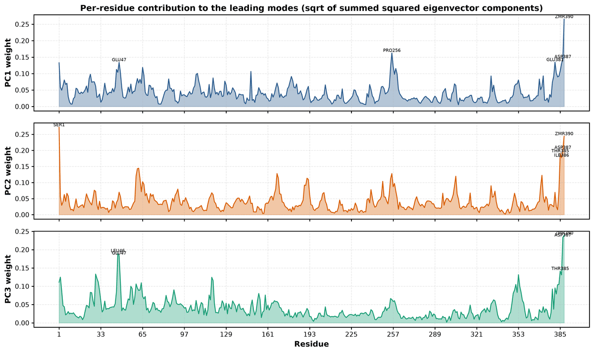

The eigenvectors are written as `pca/modes.nmd` for VMD's NMWiz, and
`pca/PC1_extremes.pdb` holds the two structures obtained by displacing the average
structure (`pca/average.pdb`) to the minimum and maximum projection on PC1.

### 4.2 The landscape (`fel/`)

`fel/free_energy.csv` is the tabular landscape (CV1, CV2, ΔG, probability) on the
12 × 12 grid, `fel/free_energy.npy` the same as a 2-D array. Only 27 of the 144 bins
are occupied; the rest are `NaN`, not zero, and are drawn in grey. The highest
sampled bin sits at 5.48 kJ/mol, which is simply kT ln 9: the most populated bin
holds 9 frames and the highest one a single frame.

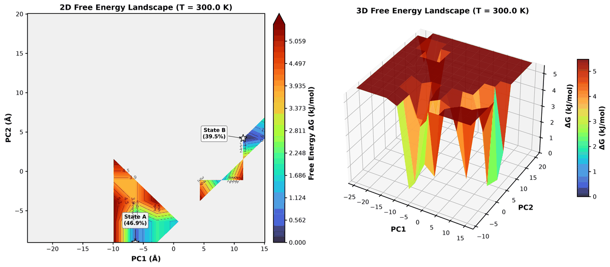

The bootstrap standard deviation of ΔG per bin (`fel/free_energy_bootstrap_sd.npy`)
is between 0.96 and 2.14 kJ/mol; the landscape is drawn next to it in
`figures/fel_uncertainty.png`.

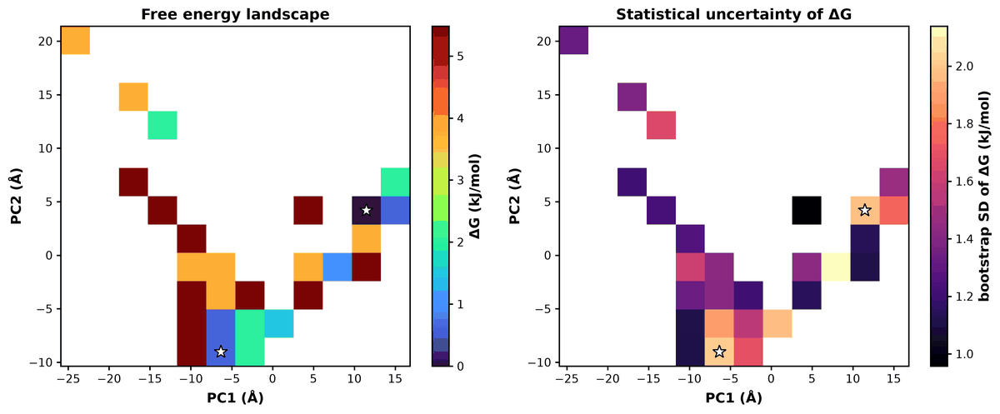

`figures/fel_1d.png` shows the one-dimensional profiles obtained by histogramming
each coordinate on its own (a finer grid than the 2-D landscape), with the 95 %
block-bootstrap band. Along PC1 the two wells are separated by a ridge, but the band
is several kJ/mol wide at every point, comparable to the ridge itself: on this
trajectory no barrier height can be stated. The profiles are drawn only; they are
not written as a table.

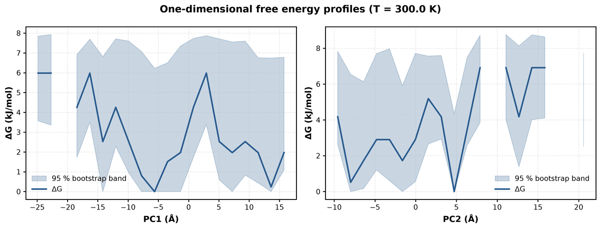

### 4.3 States (`states/`)

`states/basins.csv`:

| State | Population (%) | Min PC1 (Å) | Min PC2 (Å) | ΔG at minimum (kJ/mol) | Representative |
|---|---|---|---|---|---|
| State A | 46.9 | −6.33 | −9.04 | 0.63 | frame 29, 7250 ps |
| State B | 39.5 | 11.48 | 4.20 | 0.00 | frame 68, 17000 ps |

13.6 % of the frames fall into minor basins below the 5 % population threshold
(`--min-state-population`) and are reported as "Unassigned / Minor"; they are the
six isolated one-bin basins in the upper left of the basin map, holding one to four
frames each (`states/frame_assignments.csv`).

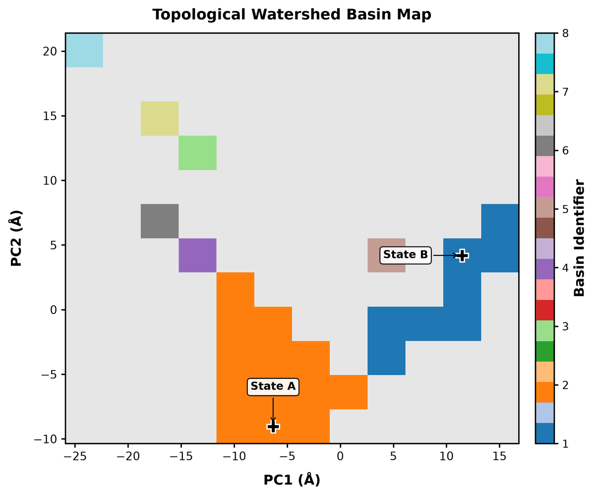

State A is the lower-left well sampled during the first half of the run, State B
the upper-right well of the second half; the two wells are not connected by sampled
bins, so `states/barriers.csv` is empty (a saddle can only be measured between
*adjacent* basins). With smoothing (`--smooth-sigma 1`) or fewer bins the gap
closes, but the barrier estimated from it would rest on a handful of frames.

`states/state_free_energies.csv` and `statistics/state_populations.csv` carry the
block-bootstrap 95 % intervals:

| State | Population (%) | Bootstrap 95 % CI (%) | ΔG vs State A (kJ/mol) | 95 % CI |
|---|---|---|---|---|
| State A | 46.9 | [12.3, 80.2] | 0 (reference) | — |
| State B | 39.5 | [11.1, 75.3] | 0.43 | [−4.26, 4.89] |

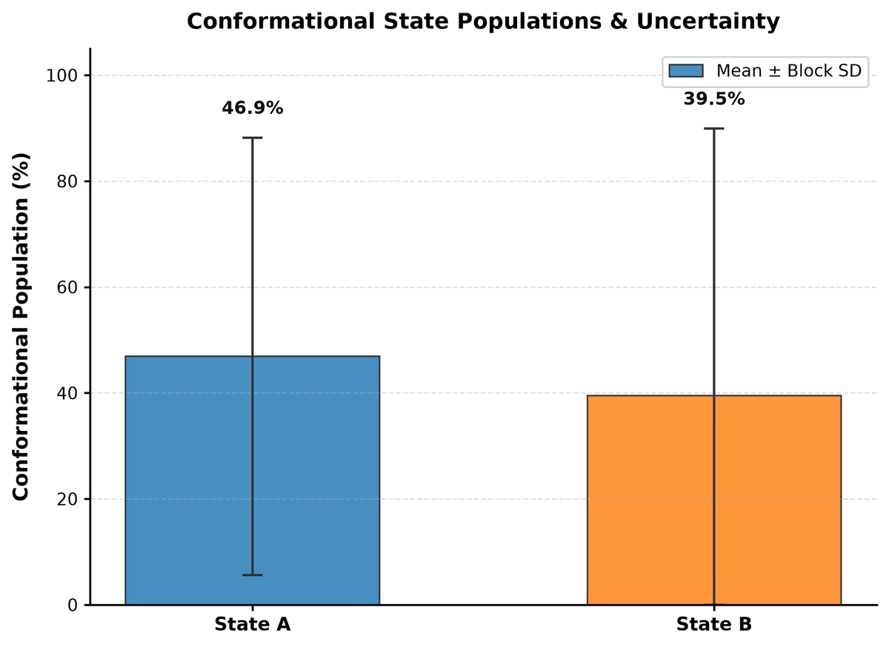

The intervals span most of the possible range: with 3 independent blocks of 27 frames in the
trajectory, the population of either state is undetermined to
within roughly ±35 percentage points. The point estimates (46.9 % and 39.5 %) are
therefore not a result about neuraminidase; they are a demonstration of what the
uncertainty machinery reports when the sampling is inadequate.

Each `states/State_X/` directory holds `representative.pdb` (the frame closest to
the basin minimum in PC space; `--representative medoid` selects the medoid
instead), `average.pdb`, per-atom and per-residue RMSF within the state and a
`metadata.json` with the frame index and time. `states/state_ensemble_summary.csv`
shows 38 frames in State A and 32 in State B, with mean Cα RMSD to the reference of
2.27 Å and 2.51 Å respectively.

### 4.4 Kinetics (`kinetics/`)

With one replicate and one transition the kinetics tables are nearly empty, which
is the correct answer: `kinetics/transition_matrix.csv` has P(A→A) = 0.974,
P(A→B) = 0.026 (one exit in 38 frames) and P(B→B) = 1; `dwell_summary.csv` records
one censored visit per state (9.5 ns in A, 8.0 ns in B, both cut by the start or
end of the trajectory); the Markov mean first-passage time A→B is 9500 ps and
B→A is undefined because B was never left.

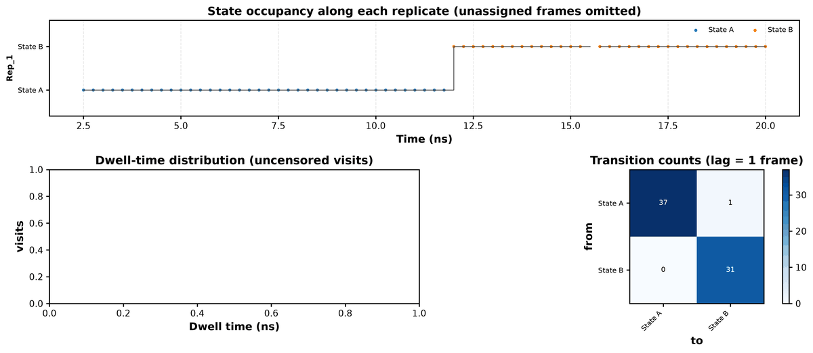

The lag-1 transition matrix assumes that the state sequence is Markovian at the
frame spacing (250 ps); a single transition cannot test that assumption.

### 4.5 Descriptors (`descriptors/`)

`descriptors/summary.csv` (all values in Å, relative to the PDB reference after
Cα superposition):

| Quantity | Mean | SD | Max |
|---|---|---|---|
| Cα RMSD | 2.30 | 0.34 | 2.74 |
| Radius of gyration | 19.24 | 0.07 | — |
| Zanamivir RMSD after protein fit | 3.49 | 0.55 | 4.47 |

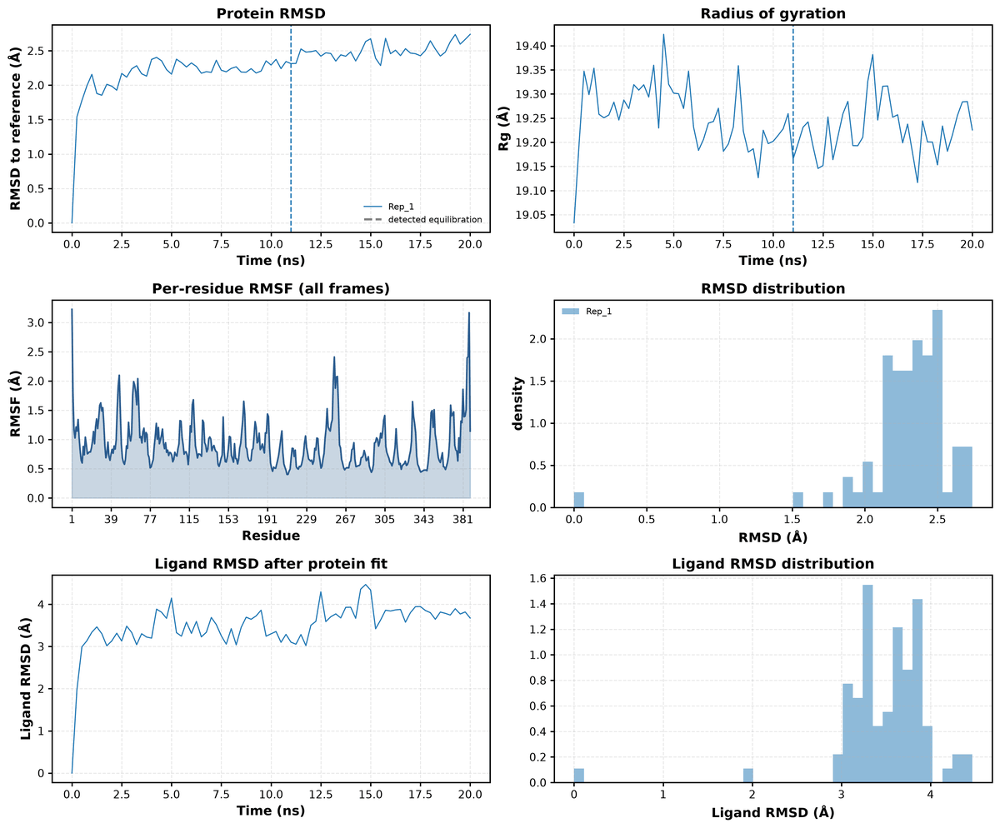

The Cα RMSD rises during the first nanosecond and then drifts slowly from 2.2 to
2.7 Å without plateauing; the dashed line marks the equilibration point detected on
this series (11 ns, Section 4.6). The ligand RMSD of 3.5 Å is the displacement of
the zanamivir heavy atoms relative to their position in frame 0 after fitting on
the protein; it includes the ligand's own reorientation in the pocket. The
per-residue RMSF (`descriptors/rmsf_residues.csv`) peaks at the termini (Ser1
3.22 Å, Asp387 3.17 Å) and at the loop around Pro256 (2.41 Å), the same residues that
carry the largest PC1 weights.

### 4.6 Convergence and effective sample size (`convergence/`)

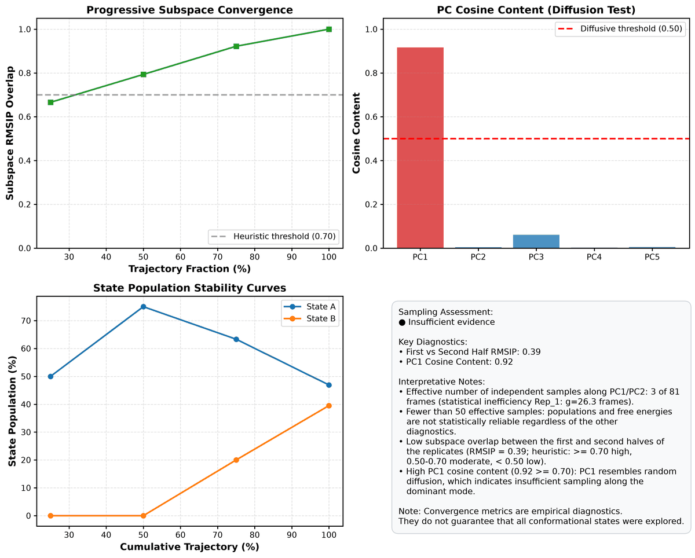

- **Half-vs-half RMSIP** (`rmsip.csv`): 0.39. The essential subspaces (top 10
  modes) of the first and second 10 ns share little; values above 0.7 are usually
  taken to indicate a converged subspace (Amadei et al. 1999).
- **Cosine content of PC1** (`cosine_content.csv`): 0.92. A value near 1 means the
  projection looks like a half-period cosine, which is what random diffusion
  produces (Hess 2000, 2002); PC1 is unconverged drift rather than a sampled
  transition between states.
- **Progressive overlap** (`progressive_overlap.csv`): the subspace of the first
  25/50/75 % of the trajectory overlaps the full subspace by 0.67, 0.79 and 0.92.
  The trend is upward but has not flattened.
- **Population stability**: State B has zero population in the first half and
  39.5 % at the end, i.e. the state list itself is still changing with simulation
  time.
- **Statistical inefficiency** (`effective_samples.csv`): g(PC1) = 26.3 frames,
  g(PC2) = 14.6 frames, giving N_eff = 3.1 effective frames out of 81.
- **Equilibration** (`equilibration.csv`): the Chodera max-N_eff criterion on the
  fit-group RMSD places t₀ at 11000 ps (frame 44); discarding those frames would
  raise N_eff of the RMSD series from 7.4 to 14.5 because the remaining 37 frames
  are less correlated. The detection is reported only; `--equilibration auto` or
  `-b 11000` would apply it.

The verdict "Insufficient evidence" follows from any of these on its own; fewer
than 50 effective frames forces it regardless of the other diagnostics.

(tutorial-why-neff)=
### Why N_eff is so small, and what a publishable run needs

The statistical inefficiency g = 1 + 2τ is the number of frames over which the
projection stays correlated; N_eff = N / g is the number of statistically
independent samples. Here g(PC1) = 26.3 frames at 250 ps spacing corresponds to a
correlation time of about 6.6 ns, so a 20 ns trajectory contains roughly three
independent observations of PC1. Every population and ΔG in this run is estimated
from three numbers, which is exactly what the ±35-point bootstrap intervals say.

Saving frames more often would not help: g is measured in frames, N_eff in
independent *time*, and the correlation time is a property of the protein. To
bring N_eff above the pipeline's floor of 50 at this correlation time one needs on
the order of 50 × 6.6 ns ≈ 330 ns of sampling, and more if the slow mode has not
yet been identified. A defensible protocol for a system of this size is three or
more independent replicates (different initial velocities) of several hundred
nanoseconds each, analysed together with `-f rep1.xtc -f rep2.xtc -f rep3.xtc`:
the replicates then give inter-replicate standard deviations and Welch's t-test in
`compare`, the half-vs-half RMSIP should exceed 0.7, the cosine content of PC1 should
fall well below 0.5, and the population-stability curves should be flat over the
last half of each replicate.

### 4.7 Provenance (`run_metadata.json`, `summary.json`)

`run_metadata.json` records the command line, the ConformAtlas version, temperature,
grid, selections, superposition settings, bootstrap settings, the detected GROMACS
version and the warnings; `summary.json` repeats the headline numbers in
machine-readable form:

```python
import json

summary = json.load(open("tutorial/analysis/summary.json"))
for s in summary["states"]:
    print(s["label"], round(s["population_percent"], 1), round(s["min_free_energy_kJ_mol"], 2))
print(round(summary["unassigned_population_percent"], 1), summary["convergence"]["assessment"])
```

```text
State A 46.9 0.63
State B 39.5 -0.0
13.6 Insufficient evidence
```

## 5. Compare two "systems" built from the two halves

`conformatlas compare` projects several systems onto one shared PCA basis and
tests the differences between them. There is only one system here, so we
manufacture two: `early` (0–10 ns) and `late` (10–20 ns), each cut into two
"replicates" of about 5 ns. The two systems are the two halves of one trajectory,
so any difference between them is a *sampling* difference, which makes this a
useful control: a comparison tool that finds significant differences between the
halves of a single trajectory is reporting the lack of convergence seen above, not
biology.

```bash
mkdir -p tutorial/split
D=tests/data/h1n1_ca
gmx trjconv -quiet -f $D/neuraminidase_ca.xtc -b 0     -e 4750  -o tutorial/split/early_rep1.xtc
gmx trjconv -quiet -f $D/neuraminidase_ca.xtc -b 5000  -e 9750  -o tutorial/split/early_rep2.xtc
gmx trjconv -quiet -f $D/neuraminidase_ca.xtc -b 10000 -e 14750 -o tutorial/split/late_rep1.xtc
gmx trjconv -quiet -f $D/neuraminidase_ca.xtc -b 15000 -e 20000 -o tutorial/split/late_rep2.xtc
```

The comparison is described by a YAML file. Relative paths are resolved against
the directory of the YAML file:

```bash
cat > tutorial/comparison.yaml <<'EOF'
project: early_vs_late
temperature: 300.0
output_dir: comparison
index_file: ../tests/data/h1n1_ca/index.ndx

pca:
  fit_group: C-alpha
  analysis_group: C-alpha
  reference: combined
  components: 10

bins: 12
min_state_population: 0.05
n_bootstrap: 200
seed: 0

systems:
  - name: early
    topology: ../tests/data/h1n1_ca/neuraminidase_ca.pdb
    trajectories:
      - split/early_rep1.xtc
      - split/early_rep2.xtc
  - name: late
    topology: ../tests/data/h1n1_ca/neuraminidase_ca.pdb
    trajectories:
      - split/late_rep1.xtc
      - split/late_rep2.xtc
EOF
conformatlas compare --config tutorial/comparison.yaml
```

```text
Built common atom mapping with 387 atoms across 2 systems.
Loaded early replicate early_Rep1: 20 frames.
Loaded early replicate early_Rep2: 20 frames.
Loaded late replicate late_Rep1: 20 frames.
Loaded late replicate late_Rep2: 21 frames.
Identified 3 major states (pop >= 5.0%): State A: 46.9%, State B: 40.7%, State C: 8.6% (Unassigned / Minor: 3.7%)
  Landscape overlap early vs late: Bhattacharyya = 0.109, JS divergence = 0.892 bits
  Essential-subspace RMSIP early vs late: 0.394
```

### 5.1 Shared coordinate space

The PCA is computed on the pooled frames with every replicate weighted equally;
the shared PC1 and PC2 carry 25.8 % and 12.4 % of the pooled variance
(`pca/explained_variance.csv`). The scatter shows the `early` frames (blue) in the
left half of the plane and the `late` frames (red) in the right half, with a
narrow overlap near the origin.

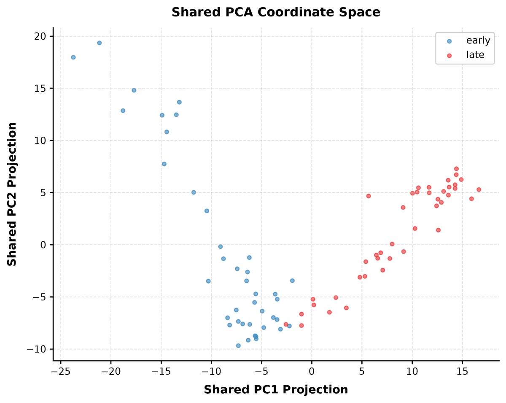

### 5.2 Populations and their significance

`comparison/state_population_comparison.csv` (populations in %, differences in
percentage points):

| State | early | late | late − early | bootstrap 95 % CI | bootstrap p | Welch t | Welch p |
|---|---|---|---|---|---|---|---|
| State A | 75.0 | 19.5 | −55.5 | [−75.6, −25.9] | 0.005 | −1.72 | 0.23 |
| State B | 0.0 | 80.5 | +80.5 | [61.0, 97.6] | 0.005 | 4.00 | 0.16 |
| State C | 17.5 | 0.0 | −17.5 | [−32.6, 0.0] | 0.070 | −1.00 | 0.50 |

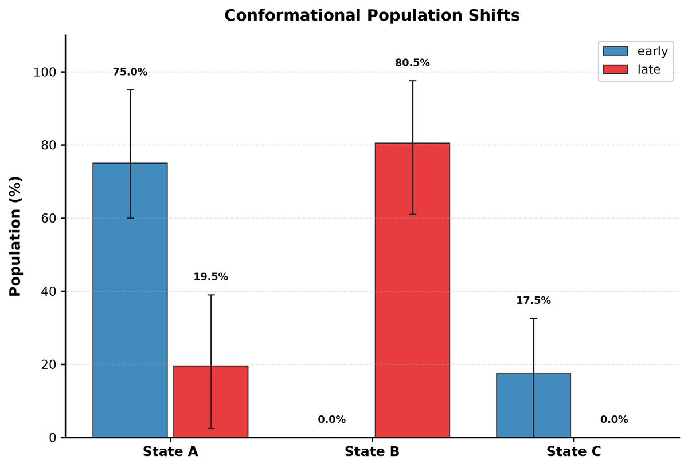

Two statistics are reported because they answer different questions:

- The **block-bootstrap p-value** resamples frames within each replicate and asks
  whether the observed difference could arise from frame-to-frame noise. It reaches
  its floor of 1/B = 0.005 for States A and B: given these frames, the two halves
  clearly occupy different regions.
- **Welch's t-test** across replicates (2 vs 2 here) asks whether the difference is
  reproducible between *independent simulations*. With two replicates per system
  the test has at most 2 degrees of freedom and p = 0.23 and 0.16: the data cannot
  show that the difference would recur in a new simulation.

The disagreement is the point. The bootstrap treats the sampled frames as the
population; the replicate test treats the simulations as the population. For a
mutant-versus-wild-type claim the second is the relevant one, and it needs three
or more replicates per system to have any power.

### 5.3 Landscape overlap and ΔΔG

`comparison/fel_overlap.csv`: Bhattacharyya coefficient 0.109, Hellinger distance
0.944, Jensen–Shannon divergence 0.892 bits (maximum 1), and only 5.9 % of the
sampled bins are shared (Jaccard 0.059). `comparison/subspace_overlap.csv` gives an
RMSIP of 0.394 between the ten leading modes computed within each system
separately, the same low value as the half-vs-half RMSIP of the single run.

The ΔΔG map (`comparison/fel_diff_late_vs_early.csv`, `figures/ddg_map_late_vs_early.png`)
is defined only where both systems sampled the bin (2 bins here); both are
hatched because |ΔΔG| is smaller than twice its bootstrap SD. State A, the only
state present in both systems, is 3.00 kJ/mol less favourable in `late`
(`state_free_energy_comparison.csv`, 95 % CI [0.0, 4.89]).

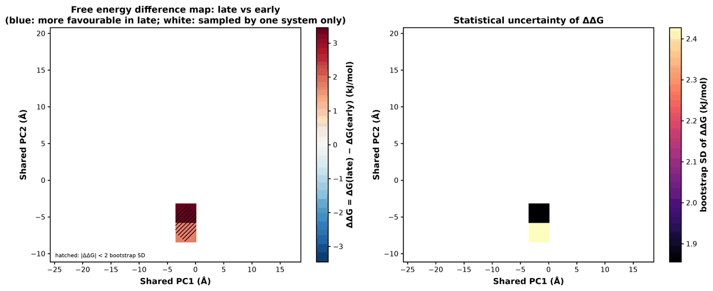

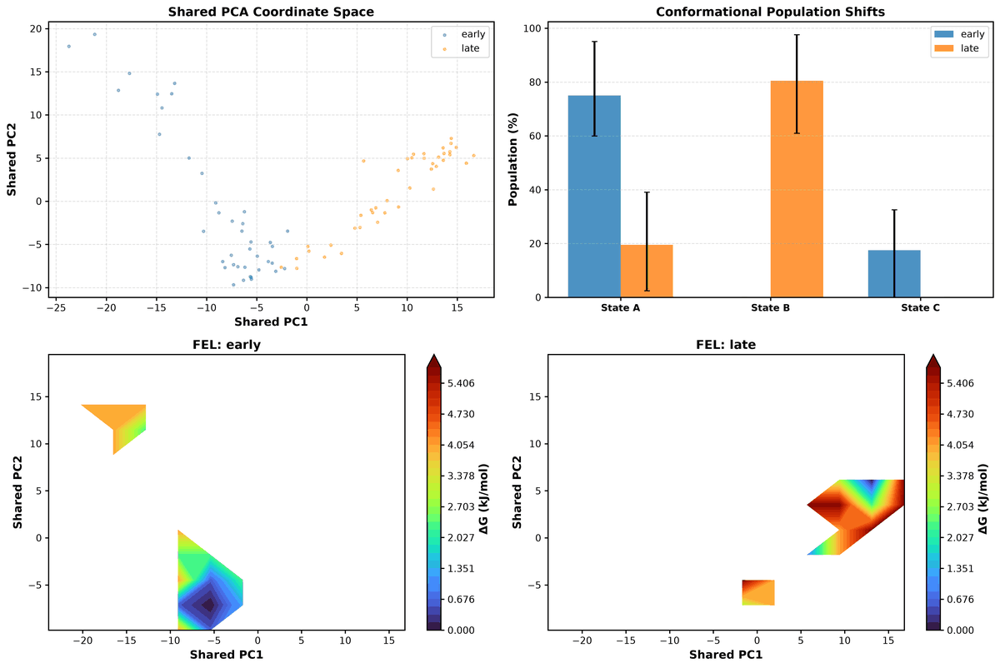

## 6. What to take away

- The pipeline reports the problems with this data set rather than hiding them:
  38 % of the variance in the plane, cosine content 0.92, RMSIP 0.39, N_eff ≈ 3,
  intervals spanning ±35 points, an empty barrier table and a detected
  equilibration point past the midpoint of the run.
- `compare` between the two halves of one trajectory finds large,
  bootstrap-significant but replicate-insignificant differences — the signature of
  unconverged sampling, and the reason both statistics are printed.
- A real study of this system needs several independent replicates of a few hundred
  nanoseconds each; the same commands, with more `-f` arguments, produce the same
  tables with meaningful intervals.

Next: [Interpretation](interpretation.md), [Convergence](convergence.md),
[Multiple replicates](multiple_replicates.md), [Comparison](comparison.md),
[FAQ](faq.md).
